# Laser_Seam_Tracking

Слідкування за зварним стиком і вимір висоти наплавленого валика за допомогою лазерної тріангуляції, Raspberry Pi та OpenCV.
Лазерна лінія ламається на кромках стика, програма на Python знаходить кромки на кадрі камери, їхні координати по Modbus RTU (RS485) надходять до промислового робота, і робот коригує траєкторію під час руху.

| Слідкування за стиком | Вимір висоти |
|---|---|
| 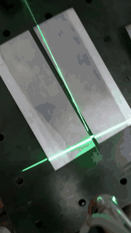 | 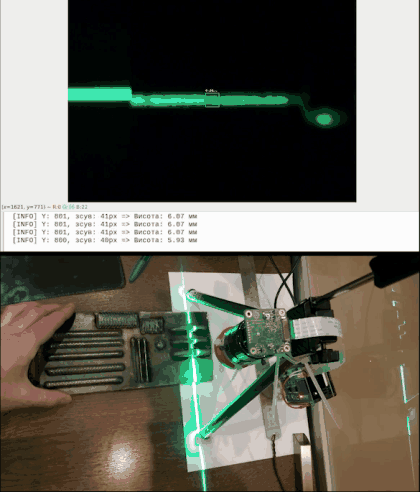 |
| Вид зверху на пластини із зазором: поперечна лазерна лінія ламається на стику, допоміжна лінія іде вздовж нього | Лазерна лінія над деталлю з рельєфом, програма в реальному часі показує висоту в міліметрах |

## Що реалізовано

- Оптичний тракт: лазерна лінія, вузькосмуговий фільтр 532 нм і нейтральний ND1000 на камері Raspberry Pi HQ. Перевірений під зварювальною дугою.
- Розпізнавання на Raspberry Pi (Python, OpenCV, picamera2): кромки стика і вимір висоти.
- Канал Raspberry Pi і робот: RS485, Modbus RTU.
- Програма робота: корекція траєкторії по X під час руху з опорним положенням, зоною нечутливості й кроком 1 мм.
- Перевірка на пластинах із зазором на роботі AIR50, на стенді й порівняння зі стереокамерою глибини.

## Обладнання

| Вузол | Що |
|---|---|
| Обчислювальний модуль | Raspberry Pi 4 Model B 4 ГБ, корпус з активним охолодженням, живлення 5,1 В 3 А |
| Камера | Raspberry Pi HQ Camera 12 Мп (IMX477), кадр 2028×1520 |
| Об'єктив | 16 мм |
| Фільтри | вузькосмуговий зелений 532 нм і нейтральний ND1000, обидва 1,25 дюйма, перехідник CS на 1,25 дюйма |
| Лазери | зелений лазер лінійної проекції, допоміжний лазер для наведення на центр стика |
| Зв'язок з роботом | плата RS485 CAN, порт `/dev/ttySC0`, Modbus RTU 9600 8N1 |
| Робот | AIR50, контролер R50, програми у файлах `.arl` |
| Перегляд кадру | ноутбук по Wi-Fi (VNC) |
| ПЗ на Raspberry Pi | Raspberry Pi OS Bullseye 64-bit, Python 3, OpenCV, NumPy, picamera2, minimalmodbus |

Вузол на руці робота: лазер, камера, Raspberry Pi з платою RS485.

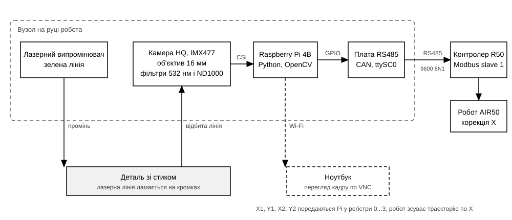

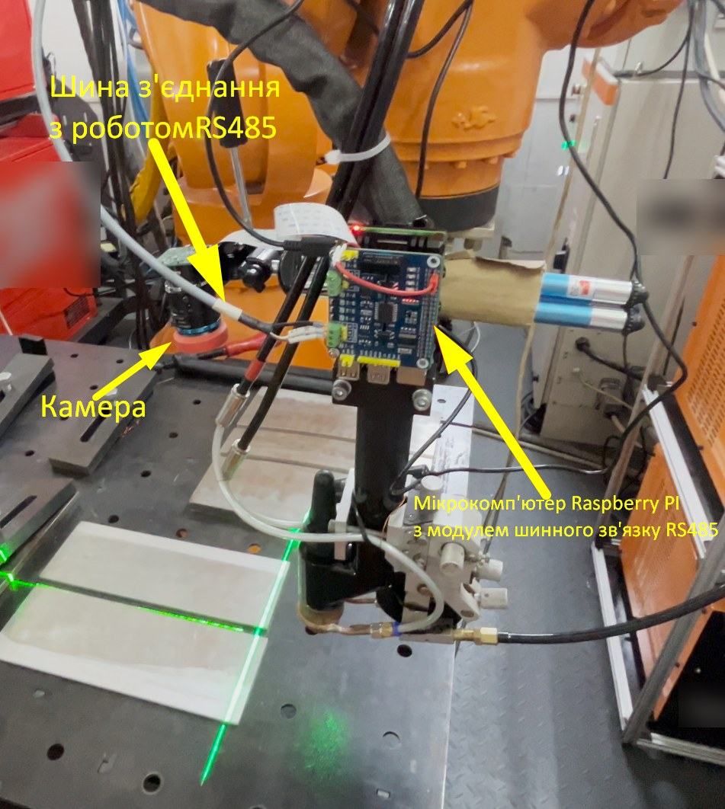

## Технічні рішення

- Фільтр 532 нм і ND1000 лишають на кадрі майже тільки лазерну лінію, тому її виділяє проста колірна маска HSV з морфологією, без важких алгоритмів.
- Відкриття ядром 3×300 прибирає короткі фрагменти лінії на дні зазору, лишаються лише довгі відрізки по обидва боки стика.
- Робот працює з відносним положенням: центр стика на старті запам'ятовується як опорний, далі підтримується те саме положення відносно камери.
- Корекція пропорційна відхиленню (коефіцієнт 0,05) із зоною нечутливості 0,125 мм, тобто шум виміру в 1-2 px не викликає зайвих рухів.
- Рух кроками по 1 мм, кожен крок починається з нового виміру.
- Обмін по стандартному Modbus RTU, а не власному форматі кадрів: Raspberry Pi master, робот slave.

## Слідкування за стиком

### Розпізнавання

Програма `src/seam_tracking/seam_detect_modbus.py` у циклі виконує такі кроки:

1. Захоплює кадр 2028×1520 через picamera2 і згладжує його білатеральним фільтром.
2. Переводить кадр в HSV і залишає пікселі з відтінком 20...120, насиченістю 40...255 і яскравістю 40...255.
3. Виконує відкриття й закриття ядром 3×3, потім відкриття ядром 3×300.
4. Знаходить контури, відбирає ті, що ширші за 200 px і мають дві вершини після апроксимації, тобто прямі відрізки.
5. Якщо відібрано рівно два відрізки, упорядковує їх зліва направо. Кромки це правий край лівого відрізка (X1, Y1) і лівий край правого (X2, Y2), Y береться посередині висоти відрізка.
6. Записує X1, Y1, X2, Y2 у регістри 0...3 по Modbus RTU.

Етапи на реальному кадрі з відео експерименту (обробка виконана цим самим кодом на комп'ютері). Знайдені кромки X1 = 632 px і X2 = 732 px, зазор 100 px.

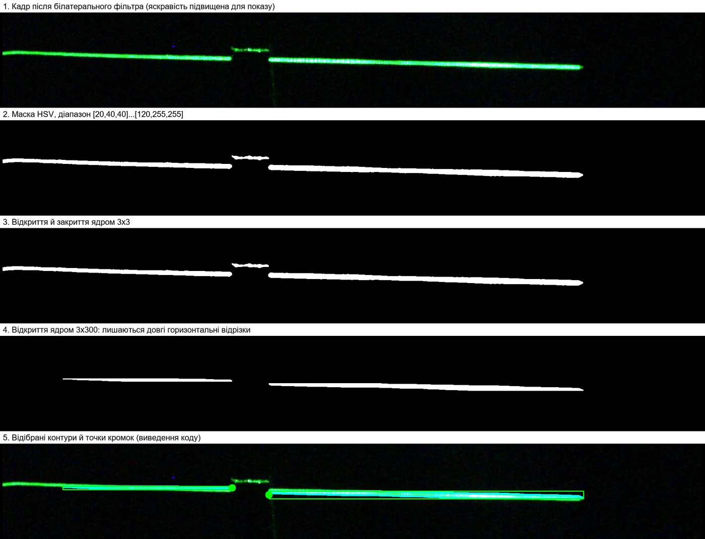

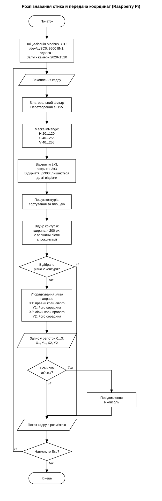

Варіант `seam_detect_profile.py` знаходить зазор за профілем яскравості. Береться смуга 20 рядків по центру кадру в зеленому каналі, середнє по стовпцях згладжується Гаусом. Біля глобального максимуму шукаються межі зі спадом яскравості більше 20, зазор це мінімум між ними. Положення зазору згладжується (коефіцієнт 0,1) і не може змінитися більше ніж на 5 px за кадр. Пошук виконується у вікні ±150 px навколо попереднього положення. У цьому файлі запис у Modbus вимкнено.

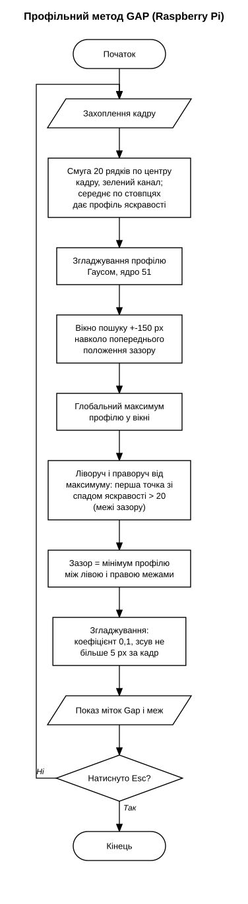

### Обмін з роботом

Raspberry Pi є master на лінії RS485 і записує чотири регістри. Робот збирає з отриманих байтів чотири значення, молодший байт іде першим. Параметри лінії, розбір байтів і оцінка швидкодії описані в [docs/modbus.md](docs/modbus.md).

| Регістр | Зміст |
|---|---|
| 0 | X1, правий край лівого відрізка, px |
| 1 | Y1, px |
| 2 | X2, лівий край правого відрізка, px |
| 3 | Y2, px |

### Програма робота

Файли `robot/Seam_follow.arl` і `robot/Seam_follow_data.arl`. У `_data.arl` задані кінцева поза `p_finish` і швидкість `v1`.

На старті робот відкриває Modbus, двічі зчитує камеру з паузами і запам'ятовує центр стика як опорне значення. Далі до кінцевої пози по Y він робить кроки по 1 мм. На кожному кроці він зчитує центр стика `(X1 + X2) / 2` і, якщо відхилення від опорного більше зони нечутливості, зсуває X на частку відхилення.

| Параметр | Значення |
|---|---|
| Крок по Y | 1 мм |
| Масштаб камери | 15 px/мм |
| Зона нечутливості | 0,125 мм (близько 2 px) |
| Коефіцієнт корекції | 0,05 |

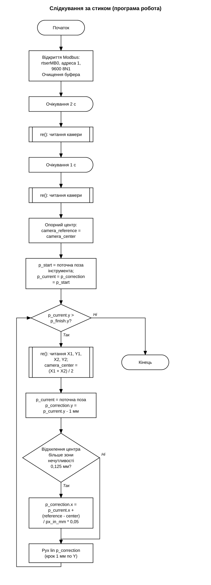

У `robot/experiments` лежать варіанти з одним безперервним рухом `lin` і корекцією з переривань: за таймером 0,1 с, за тригерами `trigger` і за умовою відхилення. Вони залишилися експериментальними, у роботі використовується покроковий варіант. Там само перша перевірка зміни пози в реальному часі, `RealTimeCorrectionPose.arl`.

## Вимір висоти

Висота валика визначається за зсувом лазерної лінії в кадрі. Зсув від базової лінії `Y = 760 px` ділиться на коефіцієнт 6,75 px/мм (135 px на 20 мм). Приклад з відео: зсув 132 px дає 19,56 мм.

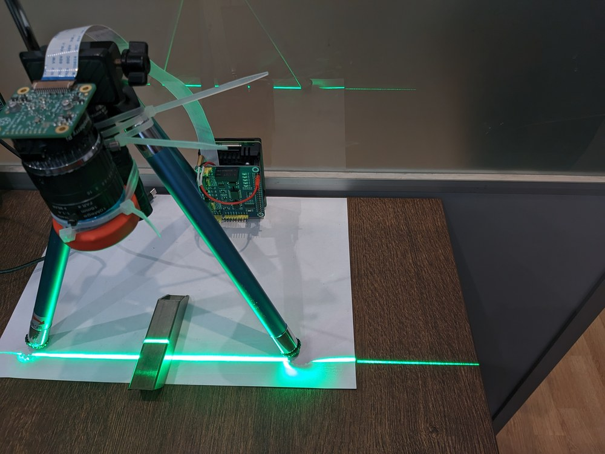

Скрипти в `src/height_measurement`, їхній склад і принцип калібрування описані в [docs/principle.md](docs/principle.md). Остання версія аналізує лише смугу ±50 px від середини кадру, тому вимір не прив'язаний до всієї деталі.

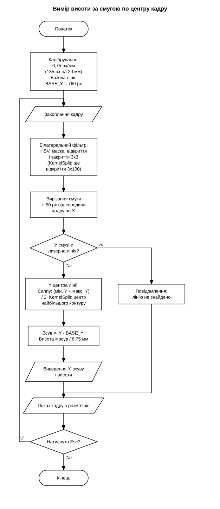

## Оптика і робота при дузі

Лазерна лінія займає вузьку смугу навколо 532 нм, дуга випромінює в усьому видимому діапазоні. Вузькосмуговий фільтр 532 нм і нейтральний ND1000 відсікають усе інше, на кадрі лишається майже тільки лазерна лінія.

| Без фільтрів | З фільтром |
|---|---|
| 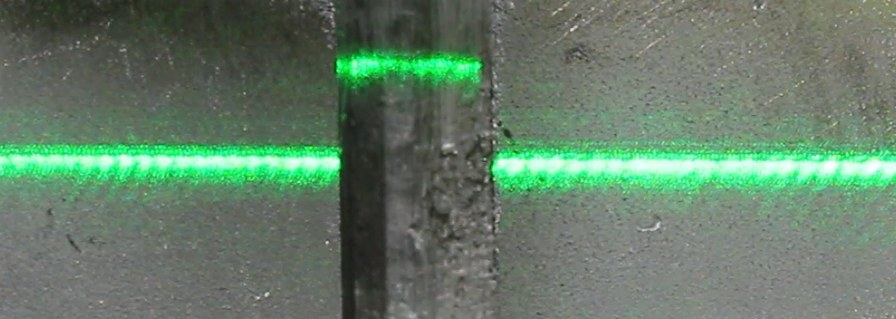 | 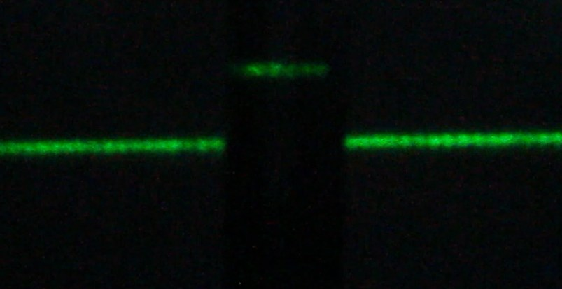 |

Фотографії експериментів з дугою, кадри відео і розбір оптичної схеми в [docs/principle.md](docs/principle.md).

## Стереокамера глибини для порівняння

У вересні 2024 для порівняння перевірено стереокамеру глибини Intel RealSense D405 (848×480, 30 кадрів/с) над стиком. Ліворуч карта глибини, праворуч колірне зображення. На карті глибини зазор видно як смугу без даних. У верхньому ряду запис без додаткової функції програми, у нижньому з вбудованою функцією: карта згладжена, але з горизонтальними смугами. Далі розвивалася лазерна тріангуляція.

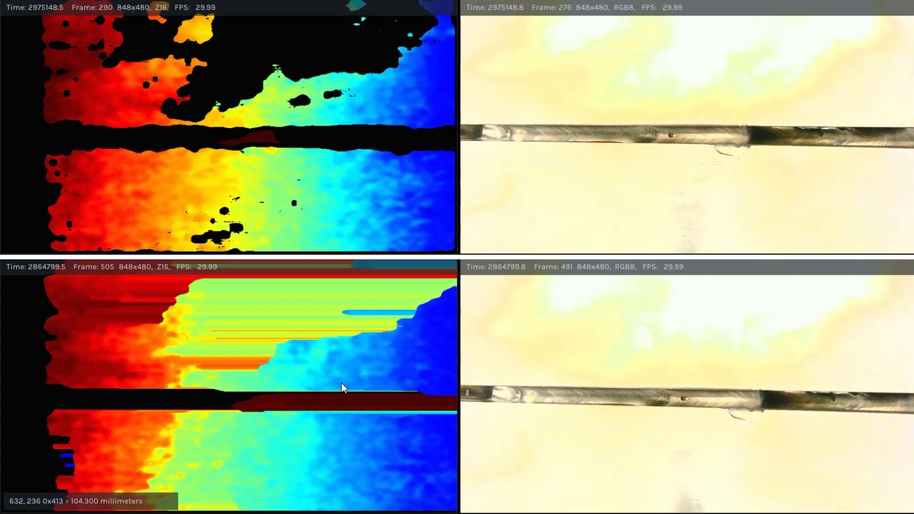

## Відео

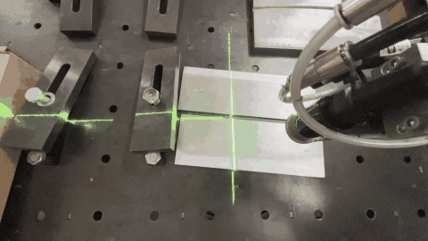

Повні записи експериментів у форматі mp4 прикріплені до [релізу](https://github.com/vomolexandr/Laser_Seam_Tracking/releases/latest): слідкування за стиком на пластинах (81 с), вид зверху (60 с) і вимір висоти (125 с).

## Перевірки

| Що перевірялося | Результат |
|---|---|
| Слідкування за стиком на пластинах із зазором, робот AIR50 | робот коригує положення по X під час руху |
| Робота під дугою, пластина з трьома площинами різної висоти | усі лазерні лінії розпізнаються, бліків від дуги немає, той самий тест раніше пройшов з фотокамерою Canon |
| Точність положення стика | за результатами експериментів краща за 0,1 мм |
| Вимір висоти | програма в реальному часі виводить зсув у пікселях і висоту в міліметрах, наприклад 132 px і 19,56 мм |

## Хронологія

| Дата | Етап |
|---|---|
| 04.08.2024 | Перші експерименти з лазерною тріангуляцією, фотокамера Canon, Python і OpenCV |
| 07.09.2024 | Обробка відеофайлу: маска HSV і контури |
| 24.09.2024 | Перевірка стереокамери глибини Intel RealSense D405 |
| 04.10.2024 | Випробування фільтра 532 нм на криволінійному шві |
| 11.10.2024 | Вибір обладнання: Raspberry Pi 4, камера HQ, об'єктив 16 мм, фільтри |
| 16.10.2024...24.10.2024 | Перенесення на Raspberry Pi (picamera2), перевірка зміни пози робота в реальному часі |
| 03.06.2025 | Відкриття ядром 3×300 для розділення відрізків |
| 06.06.2025 | Профільний метод, перша версія із записом координат у Modbus |
| 09.06.2025 | Робоча програма слідкування для робота, випробування на пластинах |
| 10.06.2025...18.06.2025 | Варіанти з перериваннями |
| 13.06.2025 | Вимір висоти |

## Як запустити

Raspberry Pi:

```
sudo apt update
sudo apt full-upgrade
sudo apt install python3-opencv libopencv-dev libatlas-base-dev python3-picamera2
pip3 install minimalmodbus
libcamera-hello
python3 src/seam_tracking/seam_detect_modbus.py
```

`libcamera-hello` перевіряє камеру. Вікно кадру відкривається на робочому столі Raspberry Pi, у тому числі через VNC. Вихід клавішею Esc. Порт плати RS485 CAN має бути доступний як `/dev/ttySC0`.

Робот: файли `.arl` із `robot/` завантажуються в контролер, у `Seam_follow_data.arl` потрібно змінити `p_finish` і `v1` під свою траєкторію.

## Обмеження і подальша робота

Обмеження:

- Якщо стик не знайдено, програма нічого не записує, і робот продовжує рух за останніми значеннями регістрів. Ознаки втрати стика немає.
- Пороги відбору (ширина відрізка, діапазон HSV) задані в коді і залежать від лазера, експозиції й відстані.
- Швидкість оновлення координат обмежена каналом 9600 бод, див. [docs/modbus.md](docs/modbus.md).

Подальша робота:

- Записувати чотири регістри одним запитом: обмін прискориться приблизно втричі.
- Додати ознаку достовірності виміру або лічильник кадрів, щоб робот зупинявся при втраті стика.
- Визначати край лінії субпіксельно, за центром ваги яскравості в стовпцях, замість меж контуру.

## Документація

- [docs/principle.md](docs/principle.md): принцип, оптика, масштаб, версії виміру висоти.
- [docs/modbus.md](docs/modbus.md): параметри лінії, регістри, оцінка швидкодії.
- `docs/system-diagram.svg`: структурна схема.
- `docs/algorithm-*.svg`: блок-схеми розпізнавання, профільного методу, програми робота і виміру висоти.
- `docs/photos/`, `docs/media/`: фото обладнання й експериментів, демонстраційні GIF.

## Структура

```
src/seam_tracking/       розпізнавання стика, Raspberry Pi
src/height_measurement/  вимір висоти, Raspberry Pi
robot/                   програма робота, experiments/ для варіантів з перериваннями
docs/                    опис, схеми, фото, GIF
```
