# Принцип роботи, оптика і калібрування

## Лазерна тріангуляція

Лазер проектує на деталь тонку лінію. Камера дивиться на неї під кутом до променя, тому будь-який перепад висоти зміщує лінію в кадрі, а зазор або крайка стика розриває її. Координати країв розривів це координати кромок стика, а величина зсуву лінії це висота.

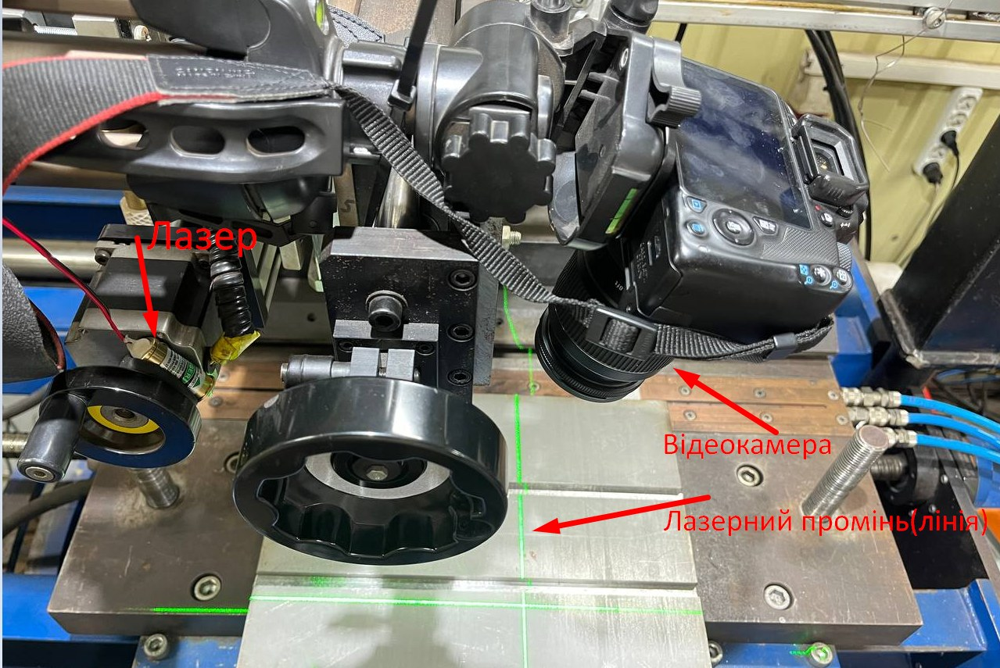

Пошук кромок зводиться до пошуку країв відрізків лазерної лінії на зображенні, де лінія яскравіша за все інше.

## Оптика і засвічення дугою

Дуга випромінює в усьому видимому діапазоні, лазерна лінія займає вузьку смугу навколо 532 нм. У системі два фільтри, обидва на 1,25 дюйма, закріплені через перехідник CS:

- вузькосмуговий фільтр зеленого світла 532 нм пропускає лише смугу лазера, решту спектра приглушує тим сильніше, чим далі вона від зеленого;
- нейтральний фільтр ND1000 (SV139) знижує загальну яскравість, щоб дуга не засвічувала матрицю.

Без фільтрів на кадрі видно поверхню, текстуру металу й відблиски. З фільтром лишається майже тільки лазерна лінія.

| Без фільтрів | З фільтром |
|---|---|
|  |  |

Програма додатково відсікає зайве маскою HSV: діапазон відтінку 20...120 (шкала OpenCV 0...180) охоплює зелений колір.

За результатами експериментів з фільтром 532 нм на криволінійному шві зникла потреба в фізичному екрані, який закривав зону дуги від камери. На початку досліджень таким екраном була фанера. Систему слідкування можна розміщувати безпосередньо перед зоною зварювання.

Перевірка під дугою виконувалася на пластині з трьома площинами різної висоти. На кадрі видно лише проекції трьох ліній різної висоти, всі лінії розпізнаються, бліків від дуги немає. Раніше такий самий тест виконано з фотокамерою Canon і фільтрами з тими самими характеристиками, пізніше його повторено з камерою Raspberry Pi HQ.

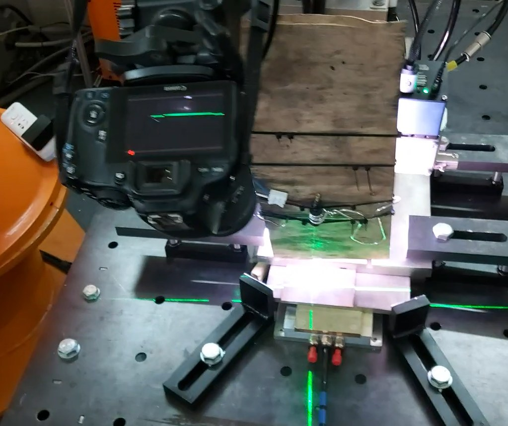

Кадри відео, лазерна лінія на тлі засвічення:

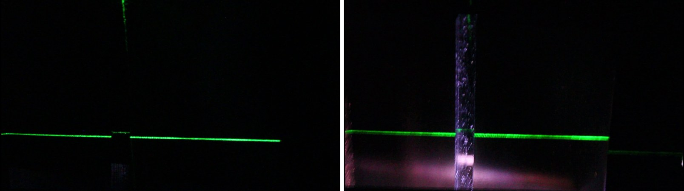

## Масштаб: пікселі в міліметри

Кількість пікселів на міліметр обернено пропорційна відстані від камери до предмета. Приклад: на відстані 50 мм проекція 2000 px відповідає 100 мм (20 px/мм). На відстані 100 мм ті самі 2000 px покривають уже 200 мм (10 px/мм). Знаючи відстань, довжину проекції в пікселях переводять у міліметри за принципом подібних трикутників.

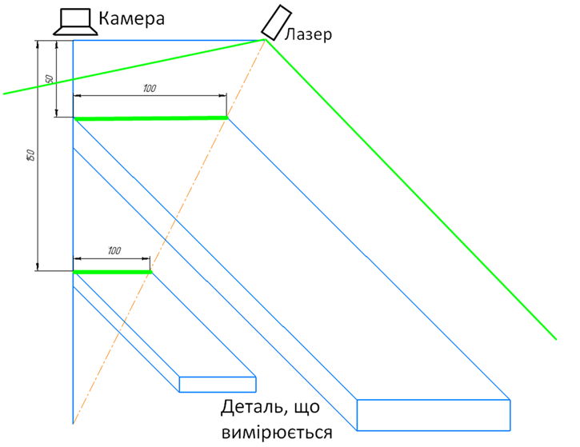

## Відстань за зсувом лінії

Камера і лазер рознесені на базу b, лазерна площина перетинає вісь камери на відстані Z0. Для схеми з рисунка b = 100 мм, Z0 = 200 мм. На відстані Z лінія зміщується від центра кадру (у площині предмета) на

```
зсув = b * (Z0 - Z) / Z0
Z = Z0 * (1 - зсув / b)
```

На Z = 200 мм зсув нульовий, на Z = 100 мм він дорівнює 50 мм. Камера бачить зсув у пікселях, тому його спочатку переводять у міліметри за масштабом із попереднього розділу.

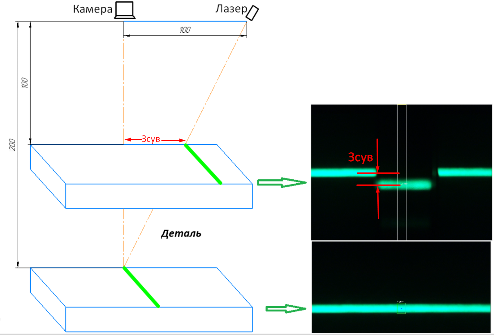

## Вимір висоти в програмі

У скриптах `src/height_measurement` застосовано простішу модель. Зсув лінії по вертикалі кадру, у пікселях, відлічується від базової лінії `BASE_Y = 760` і ділиться на коефіцієнт `PIXELS_PER_MM = 135 / 20 = 6,75`, тобто 135 px зсуву відповідають 20 мм висоти. Коефіцієнт підібраний для конкретної відстані й кута камери, при зміні геометрії калібровку виконують наново.

Приклад із відео: зсув 132 px дає висоту 19,56 мм.

| Файл | Що робить |
|---|---|
| `height_setup_lines.py` | наладка: малює горизонтальні лінії по трьох найбільших відрізках і виводить їхні Y |
| `height_3lines_canny.py` | три лінії: дві бічні опорні й центральна над деталлю, краї за Canny; висота це зсув центральної лінії від середнього Y бічних |
| `height_3lines_split.py` | три найбільші відрізки після відкриття 3×300, висота за другим з них відносно `BASE_Y` |
| `height_strip_mask.py` | аналізується лише смуга ±50 px від середини кадру, Y центра лінії це середина між найвищою і найнижчою точками маски (перетворення Canny тут не застосовується) |
| `height_strip_split.py` | те саме, відкриття 3×100, береться центр найбільшого контуру в смузі |

У попередній версії шукався один об'єкт за контуром у центральній зоні, і розпізнавання пропадало, якщо деталь зсувалася вбік. Скрипти `height_strip_*` аналізують лише вузьку смугу ±50 px по центру кадру, тому вимір не прив'язаний до всієї деталі.

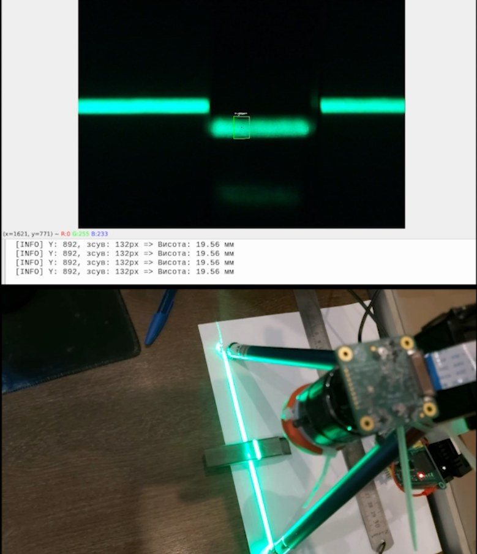

## Фотографії установки й експериментів

| | |
|---|---|
| 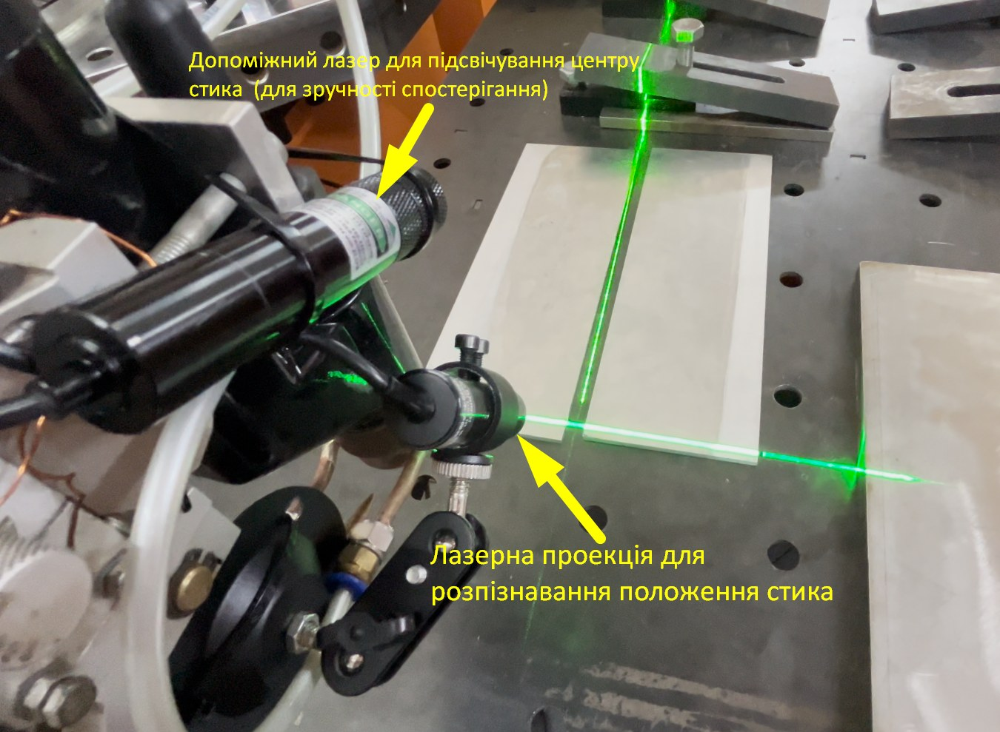 | 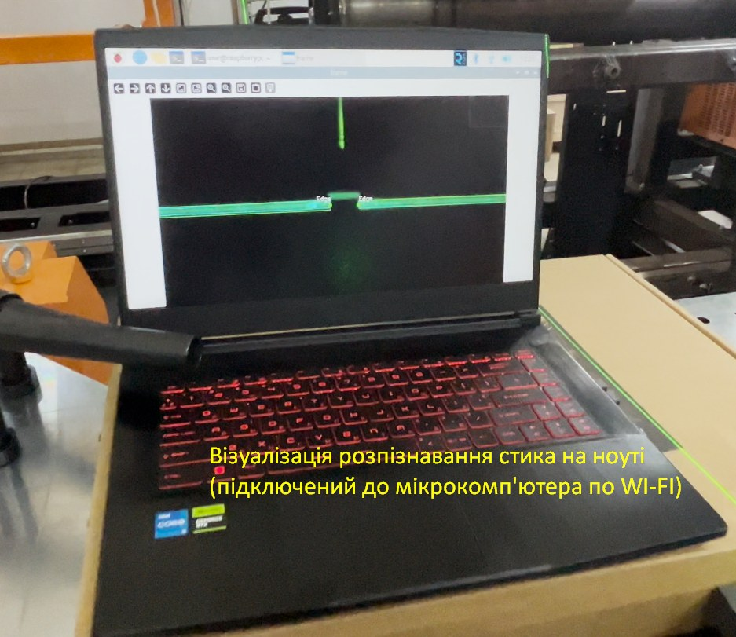 |
| Допоміжний лазер підсвічує центр стика, лазерна проекція служить для розпізнавання положення стика | Розпізнавання стика на ноутбуці, підключеному до Raspberry Pi по Wi-Fi |
| 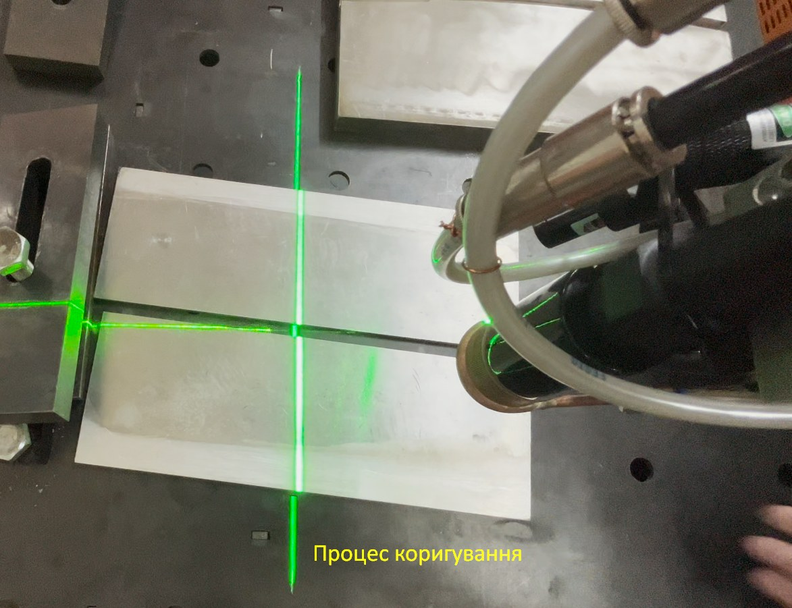 | 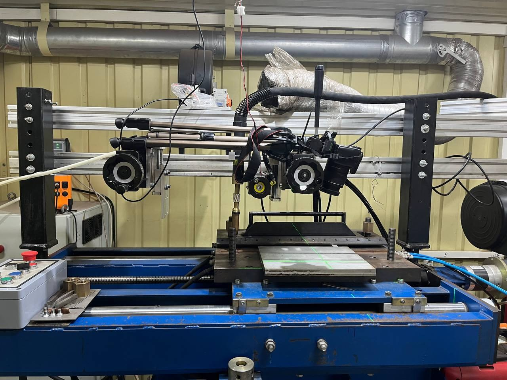 |
| Процес корекції на пластинах | Експериментальний стенд: лазер і відеокамера над пластиною |
| 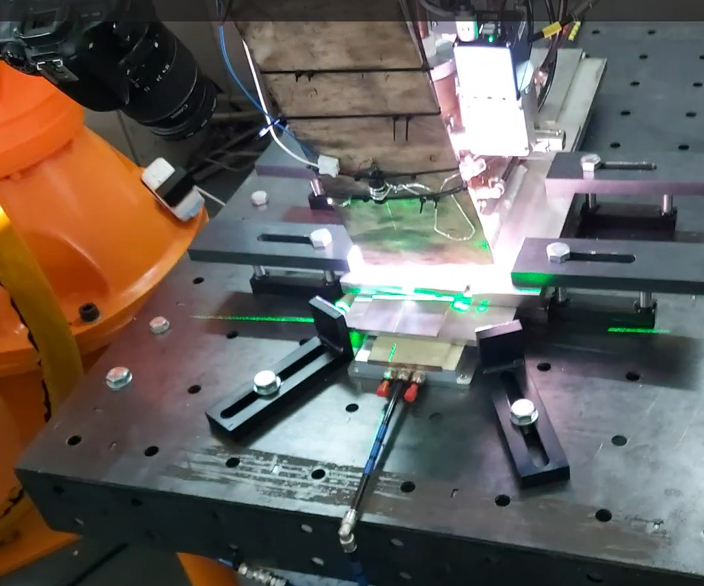 | 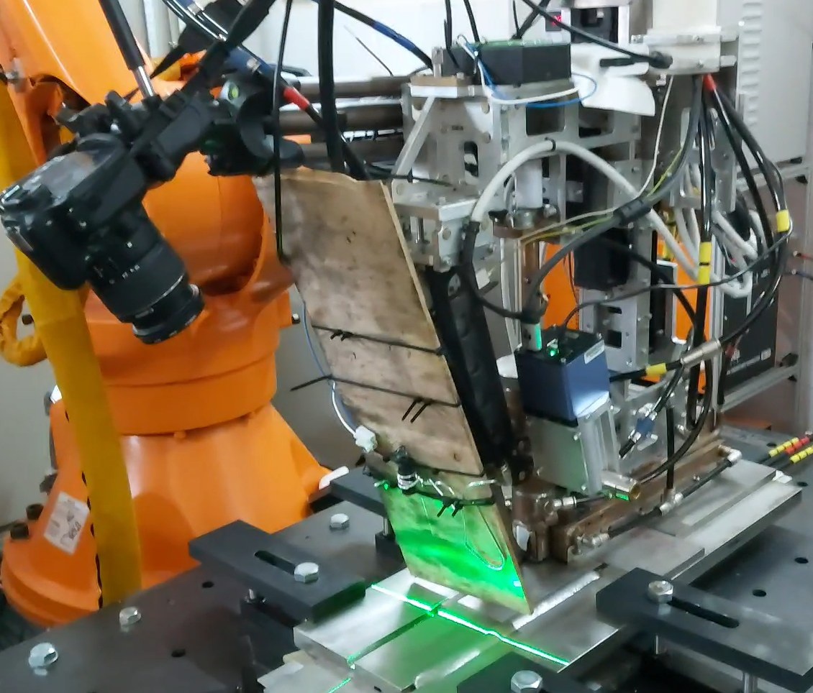 |
| Експеримент з дугою, фотокамера Canon, екран із фанери | Те саме, загальний вигляд зі сторони робота |
